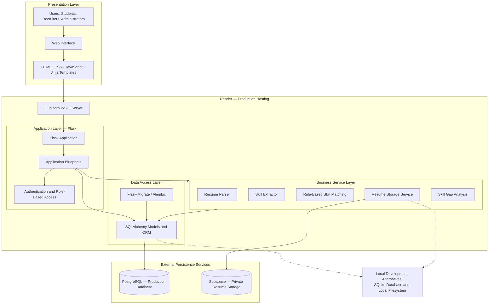

# Software Requirements Specification (SRS)

# InternMatch

### Internship Portal and Explainable Resume Ranking System

## 1. Introduction

### 1.1 Purpose

This Software Requirements Specification (SRS) document defines the functional and non-functional requirements of InternMatch.

InternMatch is a web-based internship portal that enables students to discover and apply for internship opportunities while allowing recruiters to manage internship listings and evaluate applicants using a resume-based skill-matching and ranking system.

The system provides separate interfaces and functionality for students, recruiters, and administrators.

This document serves as a reference for the design, development, testing, deployment, and evaluation of the system. It also describes the current implementation, production architecture, system constraints, and known limitations.

Detailed functional requirements and their implementation statuses are maintained separately in `docs/requirements.md`.

### 1.2 Scope

InternMatch provides a centralized platform connecting students with internship opportunities and helping recruiters evaluate applications.

The system includes the following major capabilities.

**Students will be able to:**

- Register and log in.
- Create and manage their profiles.
- Add education, skills, experience, projects, and certifications.
- Upload and replace PDF and DOCX resumes.
- Browse active internship opportunities.
- Search and filter internship listings using supported criteria.
- View internship details and skill-matching information.
- Apply for internships.
- Track application statuses.
- View or download their currently uploaded resume.

**Recruiters will be able to:**

- Register and log in.
- Create and manage internship listings.
- Specify internship descriptions and required skills.
- View applicants associated with their internship listings.
- Access applicant profiles and submitted resumes.
- View candidate match scores and matching explanations.
- Sort and rank applicants.
- Update application statuses.

**Administrators will be able to:**

- Access an administrative dashboard.
- View and manage user accounts.
- Enable and disable user accounts.
- Manage internship listings.
- Monitor application records.
- Review recorded administrative moderation activities.

The system also includes a resume-processing component that validates PDF and DOCX documents, extracts readable text, and identifies predefined technical skills.

A rule-based matching component compares the skills associated with a student's profile against the requirements of an internship. It generates a match percentage, identifies matched and missing skills, and provides an explanation of the result.

InternMatch also implements independent application resume snapshots. When a student submits an application with an available resume, the system creates a separate copy associated with that application. This preserves the submitted resume even when the student's current resume is subsequently replaced.

The matching approach is explainable and based on skill overlap. Semantic resume analysis and machine-learning-based ranking are outside the scope of the current implementation.

### 1.3 Intended Audience

This document is intended for:

- Project developers.
- Project testers.
- Project evaluators.
- Faculty members.
- Future maintainers of the system.

### 1.4 Definitions and Abbreviations

| Term | Definition |
|---|---|
| InternMatch | The internship portal and explainable resume-ranking system |
| Student | A user who searches and applies for internships |
| Recruiter | A user who creates internship listings and evaluates applicants |
| Administrator | A user responsible for managing and monitoring the system |
| Resume | A document containing a student's education, skills, experience, projects, and other relevant information |
| Resume Snapshot | An independent copy of a resume associated with a submitted application |
| Match Score | A numerical measure representing compatibility between student skills and internship requirements |
| Ranking | Ordering applicants based on their calculated match scores |
| Supabase Storage | External object storage used for production resume documents |
| PostgreSQL | Relational database used by the production application |
| ORM | Object-Relational Mapping |
| UI | User Interface |
| SRS | Software Requirements Specification |
| API | Application Programming Interface |

## 2. Overall Description

### 2.1 Product Perspective

InternMatch is a web-based application developed using the Flask framework.

The application follows a modular architecture consisting of interconnected components for authentication, profile management, internship management, application processing, resume handling, candidate matching, and administration.

The major components of the system are:

- User authentication and session management.
- Student profile management.
- Recruiter profile management.
- Internship management.
- Application management.
- Resume management and processing.
- Application resume snapshot management.
- Resume matching and candidate ranking.
- Administrative management and moderation.

The application uses a relational database for structured information and an external object-storage service for production resume documents.

The system architecture consists of the following major layers:

1. **Presentation Layer:** HTML, CSS, JavaScript, and Jinja templates used to provide the user interface.
2. **Application Layer:** Flask routes and blueprints responsible for request handling, authentication, and business workflows.
3. **Service Layer:** Resume parsing, skill extraction, storage operations, and matching logic.
4. **Data Layer:** SQLAlchemy models, database relationships, and database migrations.
5. **Infrastructure and Storage Layer:** Render hosting, PostgreSQL database, and Supabase object storage.

The high-level interaction between these components is illustrated below.



### 2.2 Product Functions

The major functions of InternMatch are described below.

**User Management**

- User registration.
- User login and logout.
- Password hashing.
- Role-based access control.
- Student and recruiter profile management.
- Session management.

**Internship Management**

- Create internship listings.
- View available internships.
- Search internship listings.
- Filter internships using supported attributes.
- Update internship listings.
- Delete eligible internship listings.
- Manage internship status.

**Application Management**

- Submit applications.
- Validate application eligibility.
- Prevent duplicate applications.
- View submitted applications.
- Track application status.
- Update application status.
- Preserve application history.

**Resume Management**

- Upload PDF and DOCX resumes.
- Validate uploaded documents.
- Replace existing resumes.
- Extract readable text.
- Identify predefined technical skills.
- Store resume documents using the configured storage backend.
- Retrieve resumes through authorized application routes.

**Application Resume Snapshot Management**

- Create independent resume copies when applications are submitted with an available resume.
- Associate snapshots with their respective applications.
- Preserve the original submitted document after current-resume replacement.
- Allow recruiters to retrieve the application-specific resume.
- Support legacy application records through the existing resume relationship when no snapshot exists.

**Resume Matching and Ranking**

- Process internship skill requirements.
- Extract recognized skills from uploaded resumes.
- Compare student skills with internship requirements.
- Calculate match percentages.
- Identify matched and missing skills.
- Generate human-readable matching explanations.
- Rank applicants based on match scores.
- Sort applicants by supported criteria.

**Administration**

- View registered users.
- Enable and disable user accounts.
- Manage eligible user records.
- Manage internship listings.
- Monitor application records.
- Record administrative moderation activities.

### 2.3 User Classes and Characteristics

**Students**

Students are users seeking internship opportunities.

Students are expected to have basic computer and web browsing skills.

Students can use the system to:

- Maintain their profiles.
- Add and manage skills.
- Upload and replace resumes.
- Discover and search internships.
- Apply for internship opportunities.
- Track application statuses.
- Review internship skill-matching information.

**Recruiters**

Recruiters represent organizations offering internship opportunities.

Recruiters can use the system to:

- Maintain recruiter profiles.
- Create internship listings.
- Define internship requirements.
- Review applications.
- Access applicant profiles.
- Retrieve application-specific resume snapshots.
- View match scores and explanations.
- Rank applicants.
- Update application statuses.

**Administrators**

Administrators are responsible for managing and monitoring the platform.

Administrators can:

- View registered users.
- Enable and disable user accounts.
- Manage eligible user records.
- View and manage internship listings.
- Monitor application records.
- Review moderation activity.

Administrative operations include safeguards that protect application history and help prevent removal of the last active administrator.

### 2.4 Operating Environment

InternMatch supports both local development and hosted production environments.

**Local Development Environment**

The local environment includes:

- Operating System: Windows, Linux, or macOS.
- Backend: Python.
- Web Framework: Flask.
- Database: SQLite by default.
- ORM: SQLAlchemy.
- Frontend: HTML, CSS, and JavaScript.
- Development Environment: Visual Studio Code or another suitable IDE.
- Browser: Modern web browser.

The application can use local filesystem storage for resume documents during development.

**Production Environment**

The deployed application uses:

| Component | Technology |
|---|---|
| Application Hosting | Render |
| Web Application Framework | Flask |
| WSGI Application Server | Gunicorn |
| Relational Database | PostgreSQL |
| Database Migrations | Flask-Migrate and Alembic |
| Resume Object Storage | Supabase Storage |
| Storage Access | Private Supabase bucket |
| Frontend | HTML, CSS, JavaScript, Jinja |

The application communicates with PostgreSQL through the `DATABASE_URL` environment variable.

Resume files are stored in Supabase Storage when the production storage backend is configured as `supabase`.

The application is accessible through a standard web browser over HTTPS.

### 2.5 Design and Implementation Constraints

The following constraints apply to the current implementation:

- Python is used for backend development.
- Flask is used as the web framework.
- SQLAlchemy is used for relational database management.
- PostgreSQL is used in production.
- SQLite is supported as the local development database fallback.
- HTML, CSS, and JavaScript are used for the frontend.
- Uploaded resumes must use supported document formats.
- PDF and DOCX files are supported.
- The maximum resume upload size is 10 MB.
- Supabase Storage is used for production resume object storage.
- Production storage uses a private bucket and application-mediated access.
- Database schema changes are managed through Flask-Migrate and Alembic.
- Resume text extraction depends on document structure and the availability of selectable text.
- Scanned PDF OCR is not currently implemented.
- Matching relies on predefined skill extraction and rule-based skill comparison.
- The current matching implementation does not use a trained machine-learning model or semantic similarity model.
- Application resume snapshots are created when a student submits an application with an available resume.
- Legacy applications may not possess independent resume snapshots and retain the existing resume relationship as a compatibility fallback.

The modular design allows individual application components to be maintained and extended without requiring a complete system redesign.

### 2.6 Assumptions and Dependencies

The system is based on the following assumptions:

- Users provide valid registration and profile information.
- Recruiters provide accurate internship information and requirements.
- Students upload supported and readable resumes.
- Users have access to a compatible web browser.
- The required Python dependencies are installed in the local environment.
- PostgreSQL is available and correctly configured in production.
- Supabase Storage is available when the production resume-storage backend is enabled.
- Resume processing depends on the availability of extractable text.
- Candidate matching depends on the quality and completeness of the student's skill profile and internship requirements.
- Environment variables and external service credentials are configured correctly in the deployment environment.

The system depends on third-party libraries and services for database management, document processing, authentication, and object storage.

Major software dependencies include Flask, Flask-SQLAlchemy, Flask-Login, Flask-Migrate, SQLAlchemy, pypdf, python-docx, psycopg, and the Supabase Python client.

### 2.7 General System Workflow

The general application workflow is illustrated below.

```text
                   User Registration
                          |
                          v
                   User Authentication
                          |
              ┌───────────┴────────────┐
              |                        |
              v                        v
           Student                  Recruiter
              |                        |
              v                        v
        Manage Profile          Manage Profile
              |                        |
              v                        v
         Upload Resume          Create Internship
              |                        |
              v                        v
       Resume Processing       Define Requirements
              |                        |
              v                        |
      Extract Recognized Skills        |
              |                        |
              v                        |
       Browse Internships              |
              |                        |
              v                        |
       Submit Application ─────────────┤
              |                        |
              v                        v
      Create Resume Snapshot     Receive Applications
              |                        |
              |                        v
              |                 View Applicants
              |                        |
              |                        v
              |                 Access Resume Snapshot
              |                        |
              |                        v
              |                 Calculate Skill Match
              |                        |
              |                        v
              |                 Rank Applicants
              |                        |
              └────────────┬───────────┘
                           |
                           v
                 Application Management
                           |
                           v
                Track Application Status
```

The administrator workflow operates separately through protected administrative routes.

## 3. Specific Requirements

This section describes the specific functional and non-functional requirements that InternMatch must satisfy.

Detailed functional requirements, including their implementation statuses, are maintained in `docs/requirements.md`.

### 3.1 Functional Requirements

The system shall provide the following major functional capabilities.

**User Management**

- User registration.
- User login and logout.
- Password hashing.
- Role-based access control.
- Student profile management.
- Recruiter profile management.
- Session management.

**Internship Management**

- Internship creation.
- Internship viewing.
- Internship searching.
- Supported internship filtering.
- Internship updating.
- Restricted internship deletion.
- Internship status management.

**Application Management**

- Internship application submission.
- Application validation.
- Duplicate application prevention.
- Application history.
- Application status tracking.
- Application status updates.
- Application resume snapshot creation.

**Resume Management**

- Resume uploading.
- Resume file validation.
- Resume replacement.
- Resume retrieval.
- PDF and DOCX text extraction.
- Predefined skill extraction.
- Resume object storage.
- Independent application resume snapshots.

**Resume Matching and Ranking**

- Internship requirement processing.
- Recognized skill extraction.
- Student skill and internship requirement comparison.
- Match score generation.
- Matched skill identification.
- Missing skill identification.
- Human-readable match explanations.
- Applicant ranking and sorting.

**Administration**

- User account management.
- Internship listing management.
- Application monitoring.
- Administrative moderation.
- Administrative activity recording.

The detailed requirements and known limitations are documented in `docs/requirements.md`.

### 3.2 Non-Functional Requirements

The system shall also satisfy the following non-functional requirements.

**Usability**

The user interface should be simple, clear, and easy to navigate for students, recruiters, and administrators.

The application provides separate dashboards and role-specific pages for its different user classes.

**Performance**

The system should provide reasonable response times for common operations such as:

- Logging in.
- Browsing internships.
- Viewing profiles.
- Uploading resumes.
- Submitting applications.
- Retrieving application records.
- Accessing stored resumes.

The current project does not define a formal response-time SLA or claim that production load and stress testing have been completed.

**Security**

The system shall:

- Protect user credentials through password hashing.
- Restrict access to role-specific functionality.
- Validate user input.
- Validate uploaded files.
- Prevent unauthorized access to protected resources.
- Enforce recruiter ownership checks for internship and application-resume access.
- Keep production credentials in environment variables rather than source code.
- Use secure session-cookie settings in production.
- Protect application and resume records from unauthorized access.

The application uses Flask-Login, role-based route decorators, session-version checks, and CSRF protection.

Production cookies are configured with Secure, HttpOnly, and SameSite attributes.

Private Supabase Storage objects are accessed through the application rather than exposing a public bucket.

**Reliability**

The system should maintain consistency of user, internship, resume, and application data during normal operations.

The application uses database transactions for important operations and creates independent resume objects for submitted application snapshots.

Resume replacement is performed by storing the new object and committing the database update before attempting cleanup of the previous current-resume object.

A failure to clean up an old storage object is logged rather than silently treated as a successful deletion.

**Maintainability**

The software uses a modular Flask application structure.

Authentication, student, recruiter, administrator, and PWA functionality are separated into application blueprints.

Database models, document-processing services, storage operations, and matching logic are maintained in separate modules.

This structure supports maintenance, testing, and future expansion.

**Scalability**

The architecture should support future expansion of user accounts, internship listings, and application records.

Production PostgreSQL and external object storage separate structured application data from resume documents.

Large-scale capacity and concurrent-load performance have not been formally benchmarked.

**Compatibility**

The system should function correctly on commonly used modern web browsers.

The web-based interface is designed to be accessed using standard browser functionality.

A comprehensive cross-browser certification has not been performed.

**Explainability**

The resume matching component shall provide understandable information about the major factors contributing to a candidate's match score.

The current implementation provides:

- Numerical match percentages.
- Matched skills.
- Missing skills.
- A textual explanation identifying the number of matched requirements.

The matching logic is based on identifiable skill overlap rather than an opaque machine-learning prediction.

### 3.3 Data Requirements

The system shall store and manage information associated with the following entities.

**User**

The User entity stores general account information, including:

- User ID.
- Name.
- Email.
- Password hash.
- Role.
- Account-active status.
- Session version.
- Account creation timestamp.

Passwords shall not be stored in plaintext.

**Student Profile**

The Student Profile entity stores student-specific information, including:

- Student ID.
- User ID.
- Phone number.
- Education.
- Profile summary.
- Skills.
- Experience.
- Projects.
- Certifications.
- Last profile update timestamp.

The student profile is associated with a user's account and may have one current resume and multiple applications.

**Recruiter Profile**

The Recruiter Profile entity stores recruiter-specific information, including:

- Recruiter ID.
- User ID.
- Company name.
- Company description.
- Contact phone.
- Last profile update timestamp.

A recruiter profile may manage multiple internship listings.

**Internship**

The Internship entity stores internship information, including:

- Internship ID.
- Recruiter ID.
- Title.
- Company name.
- Description.
- Location.
- Work mode.
- Duration.
- Stipend.
- Required skills.
- Eligibility criteria.
- Application deadline.
- Internship status.
- Creation timestamp.

An internship belongs to one recruiter and may receive multiple applications.

**Skill**

The Skill entity stores recognized and maintained skill information.

Its attributes include:

- Skill ID.
- Skill name.

Student and internship skills are associated through separate many-to-many relationship tables:

- `student_skills`.
- `internship_skills`.

**Application**

The Application entity stores information relating a student to an internship.

Its attributes include:

- Application ID.
- Student ID.
- Internship ID.
- Resume ID, where available.
- Application date.
- Application status.
- Match score field.
- Creation timestamp.
- Last update timestamp.

The system enforces a uniqueness constraint for the combination of student and internship, preventing duplicate applications.

The application is associated with its student, internship, and optional resume snapshot.

Current applicant matching results are calculated dynamically by the matching service. The existence of a nullable match-score database field does not imply that every calculated score is permanently stored.

**Resume**

The Resume entity stores information about a student's current resume.

Its attributes include:

- Resume ID.
- Student ID.
- Filename.
- Storage path.
- Extracted text.
- Upload timestamp.

A student can have one current resume record.

The file itself is stored in the configured storage backend.

**Application Resume Snapshot**

The `ApplicationResumeSnapshot` entity stores an independent copy of the resume associated with a submitted application.

Its attributes include:

- Application ID.
- Filename.
- Storage path.
- Creation timestamp.

The `application_resume_snapshots` table uses `application_id` as its primary key and as a foreign key referencing the corresponding application.

This creates an optional one-to-one relationship between Application and ApplicationResumeSnapshot.

An application may have no snapshot when a resume was not available at submission time or when it is a legacy record.

**Moderation Action**

The ModerationAction entity records supported administrative actions.

Its attributes include:

- Action ID.
- Administrator user ID, where applicable.
- Administrator name.
- Administrator email.
- Action type.
- Target user ID or internship ID.
- Target information snapshot.
- Previous value.
- New value.
- Creation timestamp.

Moderation records preserve relevant historical information for supported administrative operations.

### 3.4 External Interface Requirements

**User Interface**

The system shall provide web interfaces for:

- User registration.
- User login and logout.
- Student dashboard.
- Recruiter dashboard.
- Administrator dashboard.
- Student profile management.
- Recruiter profile management.
- Internship listings.
- Internship details.
- Internship creation and management.
- Resume upload and retrieval.
- Application submission.
- Student application history.
- Recruiter applicant management.
- Applicant resume access.
- Candidate matching and ranking.
- Administrative user management.
- Administrative internship management.
- Administrative application monitoring.

**Database Interface**

The application shall communicate with a relational database for persistent storage of:

- Users.
- Student profiles.
- Recruiter profiles.
- Skills.
- Internships.
- Applications.
- Resumes.
- Application resume snapshots.
- Administrative moderation actions.

SQLAlchemy is used for ORM-based database operations.

The application supports SQLite for local development and PostgreSQL for production.

Flask-Migrate and Alembic are used to manage database schema migrations.

**Resume Storage Interface**

The application shall communicate with the configured storage backend for resume file operations.

The supported storage backends are:

- Local filesystem storage.
- Supabase Storage.

In production, the application uses a private Supabase bucket.

The storage service provides upload, read, copy, and delete operations.

**Resume Processing Interface**

The application shall pass uploaded PDF and DOCX documents to the resume-processing component for validation and text extraction.

Extracted text is passed to the skill-extraction component.

**Matching Interface**

The skill-matching component shall receive student skill information and internship requirements.

It shall return:

- Match percentage.
- Matched skills.
- Missing skills.
- Required skill information.
- Human-readable explanation.

The recruiter interface uses this information to display applicant matching results and ranking.

### 3.5 Constraints

The following technical constraints apply to the current implementation:

- Python is used for backend development.
- Flask is used as the web framework.
- SQLAlchemy is used for relational database operations.
- SQLite is supported for local development.
- PostgreSQL is used in production.
- HTML, CSS, and JavaScript are used for the frontend.
- Git and GitHub are used for version control.
- Render is used for production application hosting.
- Supabase Storage is used for production resume files.
- PDF and DOCX are the supported resume formats.
- Resume uploads are restricted to 10 MB.
- Document parsing depends on the availability of valid, readable document content.
- Scanned PDF OCR is not currently supported.
- The skill-extraction component recognizes predefined skills and aliases.
- Matching is based on rule-based skill overlap.
- Semantic similarity and machine-learning-based ranking are not implemented.
- Application resume snapshots are stored independently of the student's current resume.

The production application requires correctly configured environment variables and accessible database and storage services.

## 4. Acceptance Criteria

The InternMatch system shall satisfy the following acceptance criteria.

### 4.1 User Management

- A new student or recruiter shall be able to register successfully.
- A registered user shall be able to log in and log out.
- Passwords shall be stored securely as password hashes.
- Users shall only be able to access functionality permitted for their roles.
- Students and recruiters shall be able to manage their respective profiles.
- Disabled accounts shall not be able to authenticate successfully.
- Administrators shall be able to access protected administrative functionality.

### 4.2 Internship Management

- Recruiters shall be able to create internship listings.
- Recruiters shall be able to update their own internship listings.
- Eligible internship listings shall be removable according to application-history safeguards.
- Recruiters shall be able to manage internship statuses.
- Students shall be able to browse active internships.
- Students shall be able to search internship listings using supported search attributes.
- Students shall be able to filter internships by supported work modes.
- Students shall be able to view internship details.

### 4.3 Application Management

- Students shall be able to apply for active internships.
- The system shall validate application eligibility and deadlines.
- Duplicate applications shall be prevented.
- Students shall be able to view their submitted applications.
- Students shall be able to view application statuses.
- Recruiters shall be able to review applications belonging to their internships.
- Recruiters shall be able to update application statuses.
- Recruiters shall not be able to access applications belonging to another recruiter's internships.

### 4.4 Resume Management and Snapshots

- Students shall be able to upload supported PDF and DOCX documents.
- The system shall reject unsupported and invalid documents.
- The system shall enforce the 10 MB upload limit.
- Students shall be able to replace their current resumes.
- The application shall extract readable text from supported documents.
- The system shall identify predefined skills from extracted resume text.
- Students shall be able to retrieve their current resumes.
- Production resume files shall be stored using the configured private Supabase Storage backend.
- An application submitted with an available resume shall receive an independent resume snapshot.
- Replacing a student's current resume shall not overwrite the snapshot associated with an existing application.
- Recruiters shall be able to retrieve the original snapshot for an application.
- Snapshot access shall enforce recruiter ownership.

### 4.5 Resume Matching and Ranking

- The system shall process internship skill requirements.
- The system shall identify recognized skills from supported resumes.
- The system shall compare student skills with internship requirements.
- The system shall calculate a match percentage when requirements are available.
- The system shall identify matched skills.
- The system shall identify missing skills.
- The system shall provide an understandable explanation of the matching result.
- Recruiters shall be able to view applicants ordered by their match scores.
- Recruiters shall be able to sort applicants using supported sorting criteria.

The acceptance criteria apply to the currently implemented rule-based matching approach and do not imply semantic resume analysis or machine-learning prediction.

### 4.6 Administrative Functions

- Administrators shall be able to view registered users.
- Administrators shall be able to manage eligible user accounts.
- Administrators shall be able to manage internship listings.
- Administrators shall be able to monitor application records.
- Supported administrative actions shall be recorded.
- Administrative safeguards shall preserve relevant application and internship history.

### 4.7 Testing and Production Verification

The completed system shall be tested to verify that:

- Core functional requirements work as specified.
- Invalid user input is handled appropriately.
- Unauthorized operations are restricted.
- Duplicate applications are prevented.
- Resume uploads are validated.
- Resume replacement works correctly.
- Application resume snapshots are preserved independently.
- Matching produces consistent results for the same inputs.
- Major application errors are handled appropriately.
- Production database connectivity and migration state are verified.
- Production resume storage and authorized retrieval are verified.

**Production verification record — 26 November 2026**

The following checks were manually completed on the deployed Render application:

- Deployment of the intended `feature/web-deployment` revision.
- PostgreSQL connection and Alembic revision `2332dec4fb2a`.
- Homepage and student authentication.
- Internship discovery.
- PDF/DOCX resume upload and validation.
- Student application submission.
- Recruiter applicant and resume access.
- Resume A to Resume B snapshot preservation.
- Recruiter ownership-based authorization.
- Matching and applicant ranking.
- Administrative dashboard functionality.
- Private Supabase bucket configuration.
- Independent storage and retrieval of the current resume and application snapshot.

The production migration diagnostic confirmed the expected PostgreSQL Alembic revision.

These checks represent manual production smoke testing. They must be distinguished from automated pytest execution, which is performed separately in the development environment.

The last documented automated testing baseline before this finalization sprint was 160 locally passing tests. A fresh full test run is required after any application-code modifications.

## 5. Conclusion

This Software Requirements Specification describes the scope, architecture, functional capabilities, non-functional requirements, data requirements, implementation constraints, and acceptance criteria of the InternMatch system.

InternMatch has progressed beyond its initial development stage and is deployed as a working web application.

The implemented system connects student internship discovery and application submission with recruiter-side applicant evaluation and administrative management.

Its major technical components include a Flask application, SQLAlchemy-based relational data management, PostgreSQL production database, private Supabase resume storage, PDF/DOCX document processing, and an explainable rule-based skill-matching system.

The application resume snapshot mechanism preserves submitted resume documents independently of subsequent changes to a student's current resume.

This document, together with the functional requirements, database design, architecture documentation, and testing records, provides the foundation for maintaining, evaluating, and extending InternMatch.

Known implementation limitations and planned improvements are documented separately so that future development can proceed without misrepresenting the current capabilities of the system.